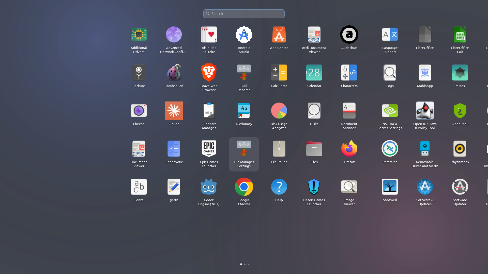
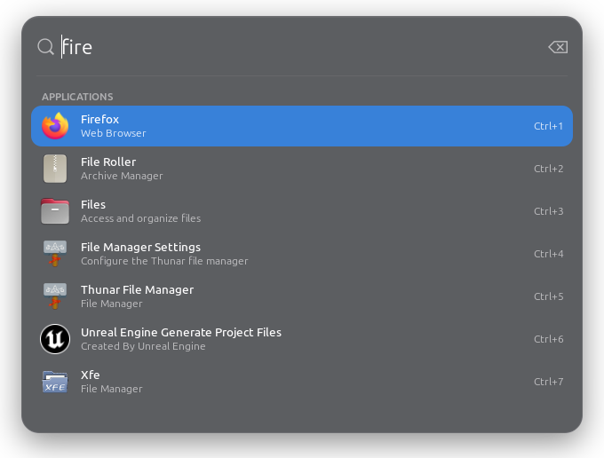
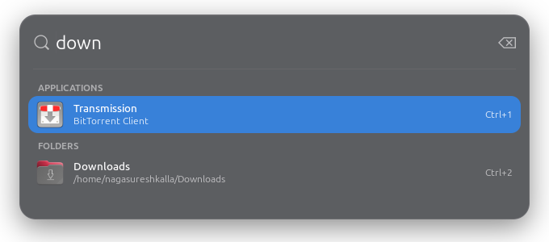
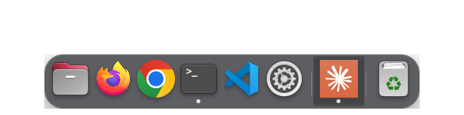
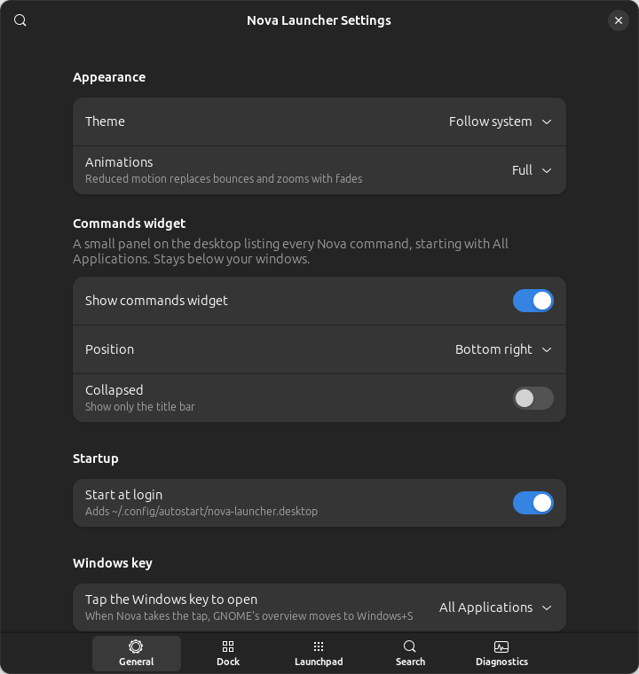
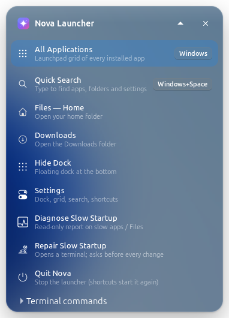
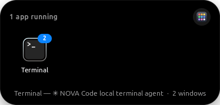

# MacLauncher: Nova Launcher for Linux

**Nova Launcher** is a fast, macOS-inspired application launcher for **Ubuntu 24.04 / GNOME 46**. It's written in
Python 3.12 with **GTK 4 + libadwaita**: no Electron and no web view. It brings a Spotlight-style quick launcher, a
Launchpad grid, a floating dock and a Dynamic Island to the Linux desktop.



| Quick launcher (Spotlight-style) | Search across apps and places |
|---|---|
|  |  |

| Floating dock | Settings | Commands widget |
|---|---|---|
|  |  |  |

| Dynamic Island (compact) | Dynamic Island (expanded on hover) |
|---|---|
|  |  |

GTK renders these screenshots from the running app (`nova-launcher --screenshot DIR`), so they never capture other
windows.

## Features

- **Quick launcher:** opens on a shortcut with focus in the search field, and shows results as you type.
  Navigate with ↑/↓/Tab, open with Enter or Ctrl+1…9, close with Esc. It also finds folders (Home, Downloads,
  mounted drives) and Nova commands such as "settings" and "diagnose".
- **Launchpad grid:** a full-screen, paged app grid with type-to-search and keyboard navigation. Drag an icon onto
  another to make a folder, or onto its edge to reorder.
- **Floating dock** (X11):
  - an All Applications button, a glass bar and smooth magnification
  - running-app dots, plus pinned, running and recent sections
  - click to focus or cycle windows, middle-click for a new window, right-click for actions
  - drag to pin, a trash, auto-hide and multi-monitor support
- **Dynamic Island** (X11): a black pill at the top of the main monitor showing the focused app. Hover or click it
  to get one tile per open window; scroll to switch.
- **Frosted glass** made from your own wallpaper, blurred once and cached. Icons come from the WhiteSur theme,
  installed per user and used only inside Nova; your system icon theme is left alone.
- **Diagnostics:** `nova-launcher --diagnose` explains a slow desktop. It found, for example, a file indexer
  crawling ~790k files and a huge Templates folder slowing down Files.

## Install

```bash
sudo apt install python3-gi python3-gi-cairo gir1.2-gtk-4.0 gir1.2-adw-1 libglib2.0-bin   # usually already present

cd nova-launcher
scripts/install.sh --dry-run     # see exactly what will be written to ~/.local
scripts/install.sh               # per-user install, no root
nova-launcher --quick            # open the quick launcher
```

Or build a Debian package with `scripts/build-deb.sh` and install it with `sudo apt install ./dist/nova-launcher_0.1.0_all.deb`.

**Make Nova the default launcher** (reversible):
- `nova-launcher --set-default` binds the Windows key to All Applications, starts Nova at login and replaces the
  Ubuntu Dock.
- `nova-launcher --restore-default` puts everything back from the saved backup.

Uninstall with `scripts/uninstall.sh`, which removes exactly the files listed in the install manifest.

## Usage

| shortcut / command | action |
|---|---|
| Windows key (after `--set-default`) | All Applications grid |
| `Super+/` | quick launcher |
| `Super+Shift+A` | Launchpad grid |
| `nova-launcher` | toggle the Launchpad grid (starts Nova if needed) |
| `nova-launcher --quick` / `--search TEXT` | quick launcher |
| `nova-launcher --settings` | settings window |
| `nova-launcher --diagnose [--report FILE]` | read-only desktop slowdown report |
| `nova-launcher --quit` | stop the running instance |

## Project layout

```
nova-launcher/
  src/nova_launcher/   app, UI (quick launcher, grid, dock, island, settings), core (app index, running apps), system
  tests/               89 pytest tests
  scripts/             install.sh, uninstall.sh, build-deb.sh, benchmark.sh
  packaging/           .desktop file, D-Bus service, Debian packaging
  docs/                screenshots, diagnostic report, test report, benchmarks
```

## Development

```bash
cd nova-launcher
python3 -m venv --system-site-packages .venv      # GTK comes from the system
.venv/bin/python -m pytest -q
```

The full guide covers performance numbers, Wayland notes, privacy and troubleshooting:
[nova-launcher/README.md](nova-launcher/README.md).

## Status

- Version 0.1.0, developed and tested on an Ubuntu 24.04 GNOME **X11** session (NVIDIA).
- Wayland isn't tested yet, and the dock and island need X11.
- Mouse drag-and-drop and magnification still need more hands-on testing.
