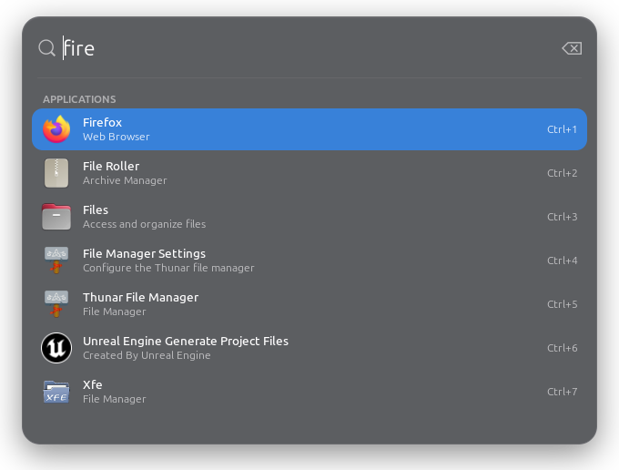
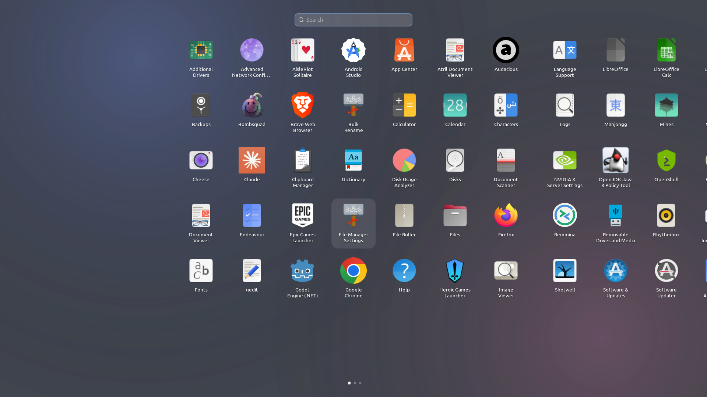
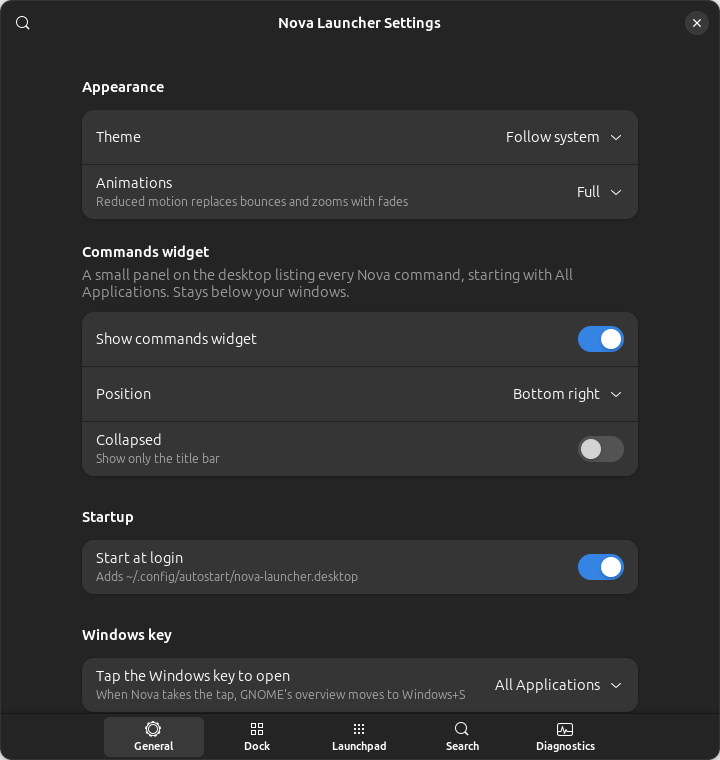
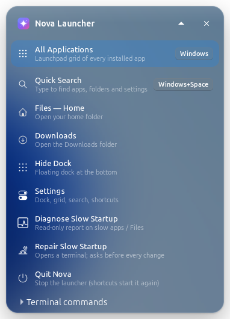
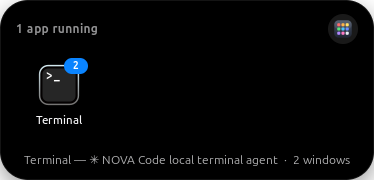

# Nova Launcher for Linux

A fast, macOS-inspired application launcher for **Ubuntu 24.04 / GNOME 46**,
written in Python 3.12 with **GTK 4 + libadwaita** (no Electron, no web view).

| Quick launcher | Launchpad grid |
|---|---|
|  |  |

| Dock (X11) | Settings | Commands widget |
|---|---|---|
|  |  |  |

| Dynamic Island (compact) | Dynamic Island (hover) |
|---|---|
|  |  |

**Look:** icons from the [WhiteSur icon theme](https://github.com/vinceliuice/WhiteSur-icon-theme)
(GPL-3.0, installed separately per-user, used only inside Nova; the system
icon theme is not changed), Ubuntu Sans type, Apple-blue accents and
**frosted glass made from your own wallpaper**. GNOME does not let apps blur
what is behind their windows, but the commands widget always sits on the
desktop and the dock lives in screen space windows don't enter, so Nova blurs
the wallpaper once (cached, recomputed only when it changes) and paints each
panel with the slice that is behind it. The Launchpad uses the whole blurred
wallpaper, like macOS. Both can be turned off in Settings → General.

Screenshots are rendered by GTK from the running app (`--screenshot DIR`), so
they never capture other windows.

## Features

* **Quick launcher** (Spotlight-style): opens on a shortcut, focus in the search
  field, results as you type, ↑/↓/Tab, Enter, Ctrl+1…9, Esc. Also finds folders
  (Home, Downloads, mounted drives) and Nova commands ("settings", "diagnose").
* **Launchpad grid**: full-screen paged grid, wheel/touchpad paging, arrow-key
  navigation, Page Up/Down, type-to-search, Esc closes, click on background
  closes. Drag an icon onto the **middle** of another to make a folder, onto its
  **left/right edge** to reorder. Folders can be renamed; right-click to remove.
* **Floating dock** (X11 sessions): starts with an **All Applications** button
  (right-click for Quick Search / Settings), glass bar, smooth magnification,
  animated name labels, running-app dots (event-driven, no polling), pinned /
  running / recent sections with separators, click to focus or cycle windows,
  middle-click for a new instance, right-click menu (desktop actions, Keep in
  Dock, Quit), drag-to-pin and reorder, launch bounce, trash, bottom/left/right,
  auto-hide, multi-monitor.
* **Dynamic Island** (X11): a black pill at the top centre of the main
  monitor, just under the GNOME top bar. Compact, it shows the focused app
  and the icons of the next few running apps; when a new app starts it
  briefly grows to say so. **Hover or click** to expand it into tiles of every
  running app (most recently used first, a green dot on the focused one, a
  badge with the window count) — click a tile to switch, click again to cycle
  that app's windows, right-click to pick a specific window, open a New
  Window or Quit. **Scroll** over the compact pill to flip between apps. By
  default maximized windows stop below it (Settings → General → Dynamic
  Island → *Keep windows below it*); it can be turned off there too. Uses the
  same event-driven window list as the dock: no polling, zero idle CPU.
* **Commands widget** (X11): a small panel in a screen corner listing every
  Nova command — **All Applications** first, then Quick Search, Files,
  Downloads, Show/Hide Dock, Settings, Diagnose, Repair, Quit — with their
  shortcuts. Click a row to run it; the *Terminal commands* section lists every
  `nova-launcher` flag (click to copy). It stays below your windows, on every
  workspace, out of Alt+Tab, and never takes focus on its own. Collapse it to a
  title bar, move it to any corner, or hide it (Settings → General, or search
  "widget" in quick search).
* **Search**: exact > prefix > word > executable/ID > substring > initials ("vsc")
  > keywords/aliases > generic name > categories > description, plus fuzzy
  subsequence and typo tolerance ("firefx", "setings"), with a small local
  usage boost.
* **Launching** through `Gio.DesktopAppInfo` (field codes, Terminal=true,
  startup notification, desktop actions) — never through a shell. Each app is
  placed in its own systemd user scope, like GNOME Shell does.
* **Files integration**: opens folders via `org.freedesktop.FileManager1` with a
  timeout; if the file manager hangs, you get a notification instead of a frozen
  launcher.
* **Diagnostics**: `nova-launcher --diagnose` — read-only report of why apps /
  Files start slowly; `--repair` offers fixes one at a time and asks first.
* **Settings**: theme (system/light/dark), animations (full/reduced/off),
  dock, grid density, search, history, shortcuts, autostart, logging.

## Install

Dependencies (all standard Ubuntu 24.04 packages, usually already present):

```bash
sudo apt install python3-gi python3-gi-cairo gir1.2-gtk-4.0 gir1.2-adw-1 libglib2.0-bin
```

**Option A — per-user, no root** (files go to `~/.local`, listed in a manifest):

```bash
cd nova-launcher
scripts/install.sh --dry-run   # see exactly what will be written
scripts/install.sh
nova-launcher --quick
```

**Option B — Debian package (system-wide):**

```bash
scripts/build-deb.sh
sudo apt install ./dist/nova-launcher_0.1.0_all.deb
```

Then, optionally, in **Nova Settings → General** (each is opt-in and reversible):

* **Start at login** — writes `~/.config/autostart/nova-launcher.desktop`.
* **Install shortcuts** — adds GNOME custom shortcuts **Super+/** (quick
  launcher) and **Super+Shift+A** (grid). Super+Space is left alone because
  Ubuntu uses it to switch keyboard layouts; Super+A stays GNOME's app grid.
  Nova checks for conflicts first and only ever edits its own entries.

The shortcut command is `gapplication action io.github.nova.Launcher toggle-quick`,
a small C program, so a key press never waits for Python to start.

## Make Nova the default launcher

```bash
nova-launcher --set-default       # apply
nova-launcher --restore-default   # undo, exactly
```

`--set-default` first saves every value it will change to
`~/.local/state/nova-launcher/gnome-defaults-backup.json` (kept from the first
run, so repeating it never loses the originals), then:

On Linux the **Windows key is called "Super"** — they are the same key.

| Change | Before | After |
|---|---|---|
| **Tap Windows** (alone) | GNOME Activities overview | Nova **All Applications** |
| **Windows+A** | GNOME app grid | Nova **All Applications** |
| **Windows+Space** | switch keyboard layout (does nothing with one layout) | Nova **Quick Search** |
| **Windows+S** | (unbound) | GNOME Activities overview (moved here) |
| Dock | Ubuntu Dock | Nova dock, reserving screen space like Ubuntu Dock |
| Login | — | Nova starts in the background |

A *tap* means press-and-release with nothing else in between: Windows+<key>,
Windows+click/drag and holding the key never count. Nova detects taps by
listening to raw XInput2 events on its own X connection, without grabbing the
key, so every other Windows+<key> shortcut keeps working. Choose what a tap
does (All Applications / Quick Search / GNOME Activities) in Settings → General.
Nothing else in GNOME is modified. `--restore-default` puts back the saved keybindings,
re-enables Ubuntu Dock, restores the autostart state and Nova's previous
settings, then deletes the backup.

## Uninstall

Run `nova-launcher --restore-default` first if you made Nova the default.

```bash
scripts/uninstall.sh           # per-user install; keeps your settings
scripts/uninstall.sh --purge   # also removes ~/.config|.cache|.local/state/nova-launcher
sudo apt remove nova-launcher  # if installed from the .deb
```

The uninstaller removes only paths from its install manifest, Nova's autostart
file, and Nova's own GNOME shortcuts. Documents and other GNOME settings are
never touched.

## Usage

| Command | Effect |
|---|---|
| `nova-launcher` | toggle the Launchpad grid (starts Nova if needed) |
| `nova-launcher --quick` / `--search TEXT` | quick launcher |
| `nova-launcher --settings` | settings |
| `nova-launcher --background` | start resident, show only the dock |
| `nova-launcher --no-dock` | this session without dock |
| `nova-launcher --quit` | stop the running instance |
| `nova-launcher --diagnose [--report FILE]` | read-only system report |
| `nova-launcher --repair` | report, then offer fixes (asks before each) |

## Performance (measured on this machine)

Ryzen/X570, 64 GB RAM, RTX 3090 (NVIDIA 580), Ubuntu 24.04.4, GNOME 46 on X11,
206 desktop files → 90 apps. `scripts/benchmark.py` reproduces these numbers;
raw data in `docs/benchmark-results.json`.

| Operation | Target | Measured |
|---|---:|---:|
| Warm open (shortcut → first painted frame, end-to-end) | < 150 ms | **38–54 ms median, 59–150 ms p95** (3 runs; the higher p95 under heavy load from other apps) |
| Cold start (new process → first frame) | — | 380–570 ms median |
| Search, 90 real apps | < 50 ms | **0.7 ms median, 1.4 ms p95** |
| Search, 1,080 apps | < 50 ms | **7.6 ms median, 12.4 ms p95** |
| Desktop-entry scan (worker thread) | — | 32 ms |
| UI responsiveness during indexing | no blocking | main loop gap < 100 ms with a 1 s scan (tested) |
| Idle CPU while hidden | ≈ 0 | **0.0 %** over 10 s |
| Background disk scanning while idle | none | none (inotify only) |
| Memory | < 100 MB RSS | **not met as RSS: 157 MB** — see below |

**Memory, honestly:** an *empty* libadwaita app on this machine already has
138 MB RSS, of which 104 MB is file-backed shared libraries (GTK, Mesa/NVIDIA GL)
shared with every other GTK app. Nova's *private* memory is 44 MB idle,
~95 MB while the 1920×1080 grid is open, and drops back to ~67 MB 20 s after the
grid closes (Nova releases the grid's GPU surface and trims the heap). A
toolkit-level floor like this is why the < 100 MB RSS target is not reachable
with GTK 4 + NVIDIA GL; `GSK_RENDERER=cairo` saves only ~8 MB.

**Why Python and not Rust:** the hot paths are GLib/GTK C code (desktop-file
parsing, rendering, D-Bus) and the Python search is ~1 ms. The one thing
Python costs is cold start (~0.4 s import time), which the resident design
hides. Rust would not move the measured numbers enough to justify it.

## Session support and limitations

| Feature | X11 (Ubuntu default with NVIDIA) | Wayland |
|---|---|---|
| Quick launcher, grid, search, launching, Files, settings | ✅ | ✅ |
| Window placement (centred quick launcher, grid on chosen monitor) | ✅ | compositor decides |
| Floating dock | ✅ (`_NET_WM_WINDOW_TYPE_DOCK`) | ❌ GNOME has no layer-shell; would need a Shell extension |
| Running-app indicators | ✅ | ❌ |
| Dynamic Island | ✅ | ❌ (same reason as the dock) |
| Global shortcuts | ✅ GNOME custom shortcut | ✅ GNOME custom shortcut |

* No GNOME Shell source changes, no extension, no display-manager changes; the
  stock Ubuntu Dock and app grid keep working as a fallback.
* Ubuntu Dock is also at the bottom on this machine; Nova's non-auto-hide dock
  sits above it in the work area. To use only Nova's dock you can disable
  Ubuntu Dock yourself (reversible): `gnome-extensions disable ubuntu-dock@ubuntu.com`
  (undo: `gnome-extensions enable ubuntu-dock@ubuntu.com`).
* No blur behind windows: Mutter does not offer background blur to clients, so
  surfaces are translucent rather than frosted.
* Focus on keyboard-shortcut open uses the X server time and an explicit
  `_NET_ACTIVE_WINDOW` request to get past Mutter's focus-stealing prevention.
  Verified on X11: 4/4 opens via `gapplication action` were focused within
  150 ms and focus returned to the previous app on close. Not tested on Wayland.

## Privacy and safety

Normal user privileges only; no network access; launch history stays in
`~/.local/state/nova-launcher/usage.json` (bounded to 300 entries, can be
cleared or disabled); logs never include launch URIs or arguments. Desktop
entries are executed only through GIO, never a shell; search text is never
executed. Settings are schema-validated; a corrupt file is moved aside to
`settings.json.corrupt` and defaults are used.

Files Nova writes: `~/.config/nova-launcher/settings.json`,
`~/.cache/nova-launcher/apps.json`, `~/.local/state/nova-launcher/`
(`usage.json`, `nova.log` ≤ 1.5 MB, diagnostic reports).

## The original slowdown

See **[docs/diagnostic-report.md](docs/diagnostic-report.md)** for the full read-only
report. In short:

1. **Verified — file indexer overload.** Tracker is configured to index
   `~/Desktop` recursively, which holds ~790,000 files (275 GB of projects,
   datasets, node_modules, Unreal assets). Its extractor crashed 1,897 times in
   one boot and the index is broken (0 files indexed, 3,592 failures). Nautilus
   and the Desktop Icons extension both talk to Tracker over D-Bus.
2. **Verified — Nautilus warning flood** (up to ~870 GTK warnings/minute while
   browsing the Unreal project trees), and earlier "Unable to register the
   application" errors — the signature of a hung existing instance making new
   launches wait on D-Bus timeouts.
3. **Ruled out:** memory pressure, disk saturation, network mounts, D-Bus
   latency (< 10 ms), and the 2 min 52 s `evergy-rates.service` (a timer job
   nothing waits for).

Recommended fix (run `nova-launcher --repair`; nothing is changed without "y"):
stop indexing `~/Desktop` recursively and reset Tracker's cache-only index.

## Files (Nautilus) was slow: the Templates folder

Measured on this machine: going Desktop ↔ Downloads in Files took up to 15 s,
and every return to Desktop got slower the longer Files stayed open.

**Cause (verified with `strace` and an A/B test):** Unreal Engine is extracted
directly into `$HOME`, so `~/Templates` is Unreal's template folder — 5,880
files in 4,571 folders. Nautilus turns *everything* in the Templates folder
into its right-click "New Document" menu and rebuilds that menu on the main
thread on every folder change (the "duplicate child name in GtkStack:
Content/Media/…" warnings were those Unreal folder names becoming menu pages).

**Fix:** GNOME's Templates folder now points at a new, empty
`~/Documents/Templates` (one line in `~/.config/user-dirs.dirs`; the original
is saved as `user-dirs.dirs.nova-backup`). No Unreal file was moved.

| 12 round trips, D-Bus driven | Before | After |
|---|---|---|
| Desktop → Downloads | 157–552 ms | **7–24 ms** |
| Downloads → Desktop | 465 → 1,906 ms (growing) | **7–9 ms (flat)** |
| Nautilus UI thread blocked | up to 1,211 ms | **8 ms** |

Undo: `cp ~/.config/user-dirs.dirs.nova-backup ~/.config/user-dirs.dirs && nautilus -q`.
`nova-launcher --diagnose` now checks the Templates folder and `--repair`
offers this fix.

## Troubleshooting (Ubuntu 24.04 / GNOME / Wayland)

| Symptom | Fix |
|---|---|
| Shortcut does nothing | Check Settings → Keyboard → Custom Shortcuts; run `gapplication action io.github.nova.Launcher toggle-quick` in a terminal; reinstall to restore the D-Bus service file. |
| Window opens but typing goes elsewhere | Focus-stealing prevention; report with `nova-launcher --debug` log. Clicking the window works around it. |
| No dock | You are on Wayland (`echo $XDG_SESSION_TYPE`), or dock disabled in Settings. |
| Dock overlaps Ubuntu Dock | Enable auto-hide, move one of them, or disable Ubuntu Dock (see above). |
| Translucent areas are black | No compositor (rare on GNOME). Use the Light/Dark theme anyway; layout still works. |
| An app is missing | `nova-launcher --diagnose` lists hidden/invalid desktop entries and why (NoDisplay, OnlyShowIn, missing TryExec). |
| "Files is responding slowly" notification | Nautilus did not answer within the timeout (Settings → Diagnostics). Run diagnostics; other apps keep launching. |
| Icons missing | Shown with a generic icon; this never blocks launching. |
| Reset everything | `scripts/uninstall.sh --purge` then reinstall. |
| Logs | `~/.local/state/nova-launcher/nova.log`; enable Debug logging in Settings → Diagnostics. |

## Development

```bash
python3 -m venv --system-site-packages .venv   # uses Ubuntu's PyGObject
.venv/bin/pip install pytest
.venv/bin/python -m pytest -q                  # 85 tests (6 need a graphical session)
PYTHONPATH=src python3 -m nova_launcher.main --quick --debug
python3 scripts/benchmark.py
PYTHONPATH=src python3 -m nova_launcher.main --screenshot docs/screenshots
```

Layout: `core/` (discovery, index, search, launching, files — no GTK windows),
`ui/` (windows; `grid_model.py` is pure logic), `system/` (diagnostics, X11 via
ctypes, monitors, autostart/shortcuts), `packaging/`, `scripts/`, `tests/`.
